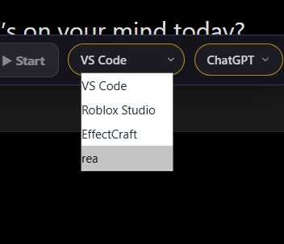

<div align="center">

<a href="https://github.com/herdodp/snapgent-connector">

</a>

<p><b>Turn any AI chatbot browser to many app via MCP</b></p>

<p><a href="https://discord.gg/rvaZ8KkvAX"><b>💬 Join Discord</b></a> to report problem</p>

[](LICENSE)
[](https://developer.chrome.com/docs/extensions/develop/migrate/what-is-mv3/)
[](https://github.com/herdodp/snapgent-connector/releases/tag/V3.9.4)
[](https://modelcontextprotocol.io/)

</div>

```console

  ███████╗███╗   ██╗ █████╗ ██████╗  ██████╗ ███████╗███╗   ██╗████████╗
  ██╔════╝████╗  ██║██╔══██╗██╔══██╗██╔════╝ ██╔════╝████╗  ██║╚══██╔══╝
  ███████╗██╔██╗ ██║███████║██████╔╝██║  ███╗█████╗  ██╔██╗ ██║   ██║
  ╚════██║██║╚██╗██║██╔══██║██╔═══╝ ██║   ██║██╔══╝  ██║╚██╗██║   ██║
  ███████║██║ ╚████║██║  ██║██║     ╚██████╔╝███████╗██║ ╚████║   ██║
  ╚══════╝╚═╝  ╚═══╝╚═╝  ╚═╝╚═╝      ╚═════╝ ╚══════╝╚═╝  ╚═══╝   ╚═╝

  > browser extension + local bridge for VS Code and MCP
  > no API key · no terminal · no copy-paste
```

snapgentV3 is a browser extension plus a local bridge that connects a normal AI chat to a **workspace MCP server**. It runs commands in a scoped folder you configure. Describe what you want in plain language — the extension forwards commands to the selected server through the local bridge, and returns the results to chat.

**Free and open source — no API key, subscription, or sign-in required.** The workspace root is set with `ZS_WORKSPACE_ROOT`.

---

- **Installation:** [Watch Installation Video](https://youtu.be/eo3sdtPSBso)
- **Demo:** [Watch Demo Video](https://youtu.be/HY0YWsHLp34)

- **MCP support**


- **Test snapgent connector + effect craft motion from artcraft** [Watch Video](https://youtu.be/wH_gpAWpA8E)
<table>
<tr>
<td width="100%" valign="top">

### 💻 Workspace MCP server
The default target. Connects to the workspace folder you configure with `ZS_WORKSPACE_ROOT` (Linux only). See `docs/linux-mcp-design.md`.

</td>
</tr>
</table>

---

## `01` &nbsp; How it works

```
┌─────────────┐     plain-text      ┌──────────────────┐    WebSocket    ┌────────────┐    MCP    ┌────────────────┐
│  AI chat    │ ───  commands  ───▶ │ snapgentV3       │ ──────────────▶ │  Bridge    │ ────────▶ │ Selected MCP   │
│  (browser)  │ ◀──  results   ───  │ browser extension│ ◀────────────── │ (local)    │ ◀──────── │ target         │
└─────────────┘                     └──────────────────┘                 └────────────┘           └────────────────┘
```

1. **You** describe a task in a supported AI chat.
2. The **AI** replies with a snapgentV3 command.
3. The **extension** detects the command and forwards it to the local bridge.
4. The **bridge** routes it to the VS Code MCP server.
5. The **result** is sent back into chat, and the AI continues working.

The workspace MCP server is configured locally by `setup-config.py`; it runs in the folder you set with `ZS_WORKSPACE_ROOT`.

---

## Snapgent App (standalone, Windows)

Prefer not to load an extension or run the bridge yourself? **Snapgent App** is a standalone desktop app (Electron) with a built-in AI browser, a toolbar, and the bridge built in. It needs no Chrome/Edge, no `start.bat`, no Python and no Node.js.

**Download** (pre-release `app-v0.1.0`): [Releases > app-v0.1.0](https://github.com/herdodp/snapgent-connector/releases/tag/app-v0.1.0)

| File | Use |
|---|---|
| `Snapgent.Setup.0.1.0.exe` | Installer (recommended) |
| `Snapgent-0.1.0-win-x64.zip` | Portable: extract the whole folder, then run `Snapgent.exe` |

**How to use**

1. Install and open Snapgent. It opens `claude.ai` inside the app and keeps your login in its own profile.
2. Click the workspace button in the toolbar and choose your project folder.
3. Chat as usual. The agent bar appears on the page and runs the commands in the selected folder.

**Known limitations (0.1.0)**

- The exe is **not code-signed**, so Windows SmartScreen may warn. Click **More info**, then **Run anyway**.
- **Google sign-in has not been fully tested.** If it fails, log in with email and password on the Claude page.
- Windows only. The default Electron icon is still used.

**Build from source**

The source is in [`snapgent-app/`](snapgent-app). It carries its own copy of the extension code (`snapgent-app/extension`), separate from `snapgent-extension/`.

```
cd snapgent-app
npm install
npm start        # run in development
npm run dist     # build the Windows installer into dist/
```

`snapgent-app/bin/vscode_mcp.exe` is not stored in Git. Build it from `snapgent-app/mcp/vscode_mcp.py` with PyInstaller (see `vscode_mcp.spec`) and place it in `snapgent-app/bin/` before running `npm run dist`.

---

## `02` &nbsp; Supported AI providers

| Provider | URL | Status | Notes |
|---|---|---|---|
| **ChatGPT** | `chatgpt.com` | ✅ Supported | Image input and screenshots are disabled |
| **Claude** | `claude.ai` | ✅ Supported | Image input and screenshots are disabled |
| **Google Gemini** | `gemini.google.com` | ✅ Supported | May stop using tools in long sessions |
| **Kimi** | `kimi.ai` | ✅ Supported | May use its native tools in some sessions |
| **Grok** | `grok.com` | ✅ Supported | Requires signing in to xAI |
| **Mistral (Vibe Code)** | `chat.mistral.ai` | 🧪 Experimental | Requires signing in to Mistral; selectors need testing on the live site |
| **GLM (Z.ai)** | `chat.z.ai` | ✅ Supported | |
| **Qwen** | `chat.qwen.ai` | ✅ Supported | |
| **Arena** | `arena.ai` | ✅ Supported | Use **Direct** mode |
| **Meta AI** | `meta.ai` | ✅ Supported | |
| **Ptero** | `ptero.pro` | ✅ Supported | |

> Provider activation is configured in `manifest.json` (`content_scripts` and `host_permissions`) and `PROVIDER_URLS` in `background.js`.

---

## `03` &nbsp; Requirements

- **Microsoft Edge** or **Google Chrome** (Manifest V3).
- **Linux** for the workspace MCP server target.
- **Python 3.9+** on Linux.
- The bridge running while you use the agent.

---

## `04` &nbsp; Installation

**① Load the extension**

1. Download and extract the [latest SnapgentV3 release](https://github.com/herdodp/snapgent-connector/releases/tag/V3.9.4).
2. Open `edge://extensions` (Edge) or `chrome://extensions` (Chrome).
3. Enable **Developer mode**.
4. Click **Load unpacked** and select the `snapgent-extension` folder.
5. The snapgentV3 icon appears in your browser toolbar.

**② Set up the MCP target**

Run `bash Linux_Start.sh` (or `python3 setup-config.py` with `ZS_WORKSPACE_ROOT` set). It writes the `repo` server entry to the ignored local `config.json`.

**③ Start the bridge**

- **Linux** — open a terminal in the extracted release folder and run
  `bash Linux_Start.sh`. It writes the `repo` MCP server entry pointing at your
  workspace root to the ignored local `config.json`. It uses
  `bridge.py`; the first launch installs `websockets` for your user, or creates
  a local Python environment if your distribution blocks user installs.

Keep the terminal window open while the bridge runs.

**④ Start a session**

1. Open a supported AI chat site and start a new chat.
2. Click **Start** and describe what you want to make.

**⑤ Updating to a new release**

The extension and the bridge are two separate parts, and each one has to be updated. Reloading only the extension does not update the bridge, and the **Restart** button in the extension popup only restarts the MCP servers, it does not load new bridge code.

1. Get the new version: run `git pull` in the project folder, or download and extract the [latest release](https://github.com/herdodp/snapgent-connector/releases/latest).
2. Stop the old bridge: close the terminal window that is running `start.bat`, `MacOS_Start.command` or `Linux_Start.sh`.
3. Start the bridge again with the same launcher. The launcher replaces an old bridge still holding port 17613. On Linux it first checks that the process on the port is a Snapgent bridge, and stops with an error if it belongs to another program.
4. Reload the extension at `chrome://extensions` (or `edge://extensions`), then refresh open chat tabs (F5).
5. Check the versions: click the snapgentV3 icon. The popup header shows `ext vX · bridge vY`, and both numbers should match the release you installed. The bridge also writes `snapgent bridge vY` to its startup log.

If the popup shows `bridge old`, the bridge is still running old code: repeat steps 2 and 3. On macOS and Linux, also make sure there is no old executable file named `bridge` in the folder, because the launcher runs it instead of `bridge.py`.

---

## `05` &nbsp; Usage

Once a session is running, just talk to the AI normally:

> "Inspect the files in my project and explain how the login flow works."

> "Add a search bar to the books page and wire it to the existing API."

The AI sends commands, snapgentV3 runs them in the selected target (VS Code by default), and the results appear in chat. You can give the AI another instruction at any time.

**Tips**

- Keep the bridge window open — closing it disconnects the agent.
- On **Arena**, use **Direct** mode.
- If **Gemini** or **Kimi** stops using tools in a long session, remind it to use the snapgentV3 commands or start a new chat.

---

## `06` &nbsp; Architecture

The extension is split into a **provider-agnostic core** and **per-site providers**. The core talks to each AI site through the `ZSProvider` interface.

```
core/config.js              system prompt, feedback, tool categories
core/parser.js              snapgentV3 command parsing
core/main.js                agent loop, UI, session state
providers/<site>.js         site-specific selectors and chat integration
background.js               WebSocket connection to the local bridge
manifest.json               browser permissions and content scripts
```

The bridge routes commands to the configured MCP servers. Linux runs the
cross-platform `bridge.py` with Python.

---

## `07` &nbsp; Project structure

```
snapgent-full/
├── snapgent-extension/        # Load this folder as an unpacked extension
│   ├── core/                  # Shared prompt, parser, agent loop, and UI
│   ├── providers/             # Per-AI-site integrations
│   ├── background.js          # Local bridge connection
│   ├── manifest.json          # Manifest V3 configuration
│   └── test-*.js              # Smoke tests
├── assets/                    # Project images
├── setup-config.py            # Configures the Linux workspace MCP server
├── config.json                # Generated locally by launchers (not tracked)
├── Linux_Start.sh             # Linux bridge launcher
├── bridge.py                  # Cross-platform Python MCP bridge
├── workspace_mcp.py           # Workspace MCP server source (28 workspace tools)
├── test_bridge.py             # MCP bridge protocol tests
├── test_setup_config.py       # MCP setup helper tests
├── test_workspace_mcp.py      # Workspace MCP server tests
├── scripts/e2e_live.py        # Live e2e: real bridge + subprocess on an ephemeral port
└── sync-upstream.sh           # Sync with upstream, keeping purged paths deleted
```

---

## `08` &nbsp; Security & operations

Every workspace tool is scoped to `ZS_WORKSPACE_ROOT`, with a
resolve-check on every traversed entry so symlinks cannot leak files
from outside the root. `run_command` blocks privilege-escalation and
raw-disk binaries and caps its timeout at 300 s. The bridge restarts
dead MCP servers with exponential backoff, and answers
`get_bridge_status` with per-server pid, restart attempts, and RSS.

Start with [`docs/security-and-ops.md`](docs/security-and-ops.md) for
the containment model, the `run_command` policy, bridge recovery, and
how to diagnose a running bridge (including opt-in JSON logging with
`ZS_BRIDGE_LOG_JSON=1`).

Tests: `/usr/bin/python3 -m pytest -q` (Python), `node
snapgent-extension/test-*.js` (extension stub-DOM), and
`/usr/bin/python3 scripts/e2e_live.py` (live bridge + subprocess).
GitHub Actions runs the same suites on every push/PR.

---

## `09` &nbsp; Troubleshooting

| Symptom | Likely cause | Fix |
|---|---|---|
| snapgentV3 bar is missing | Extension is disabled or site access is blocked | Check the extension is enabled and allowed on the current AI chat site, then reload the tab |
| Bridge is offline | Bridge is not running | Run `bash Linux_Start.sh` (Linux) |
| MCP server keeps dying / tools fail after a while | Subprocess crashed; the bridge restarts it with backoff (5 s → 300 s) | Send `get_bridge_status` over the WebSocket and check `restart_attempts`, `error`, and `log_tail` (see `docs/security-and-ops.md`) |
| AI replies without using tools | Provider/model stopped following commands | Remind it to use snapgentV3 commands or start a new chat |
| A configured MCP server is missing from the target dropdown | The server was switched off in the **MCP servers** panel, or the extension is outdated | Open **MCP servers** from the ⋯ menu on the snapgent bar and tick the server, then reload the extension in `chrome://extensions` and refresh the chat tab |
| Target dropdown closes or the click does nothing | Older extension versions redrew the menu during status updates | Update to the latest release and reload the extension |

---

<div align="center">

**Built for creators who want to spend more time making.**

[Latest release V3.9.4](https://github.com/herdodp/snapgent-connector/releases/tag/V3.9.4) · [Issues](https://github.com/herdodp/snapgent-connector/issues) · [License](LICENSE)

</div>
